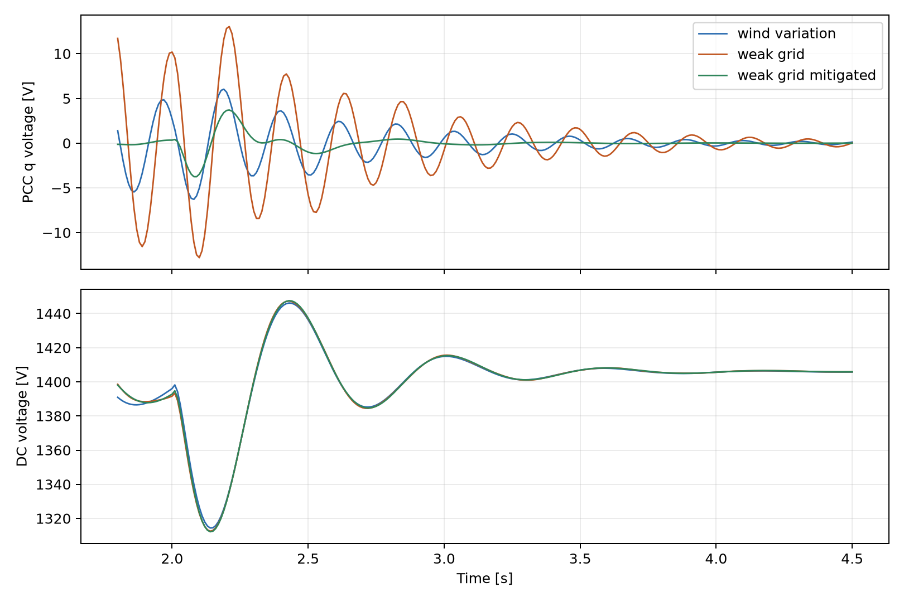
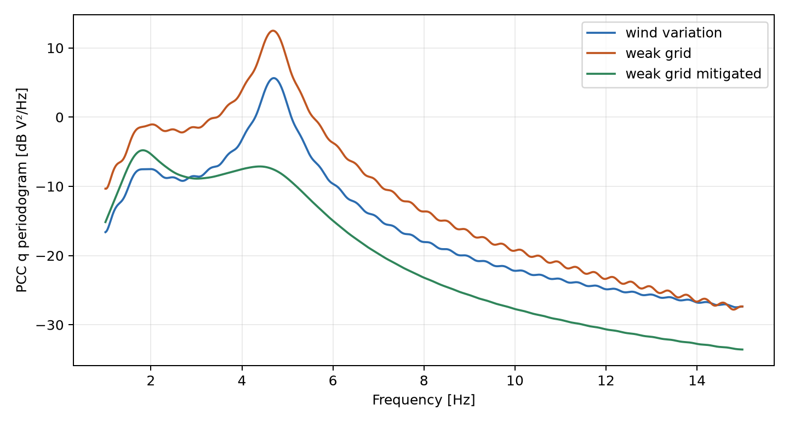
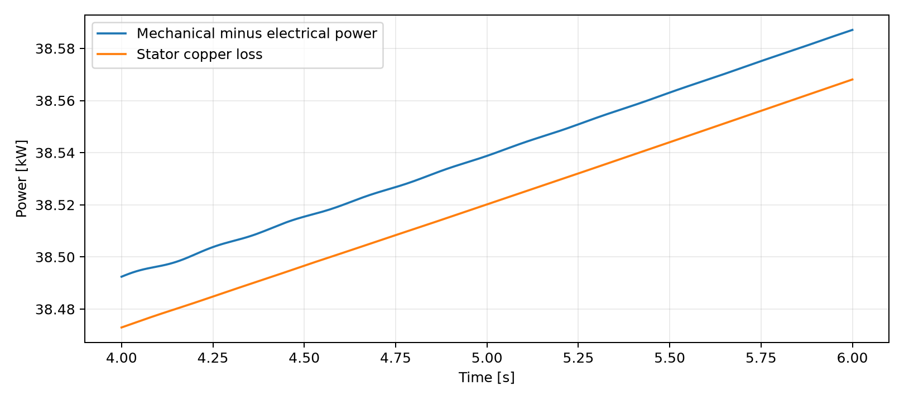

# Technical report on the physical PMSG weak grid SSO model

## Abstract

This report evaluates a saved, self-contained MATLAB R2025b Simscape Electrical model of a 5 MW permanent magnet synchronous generator (PMSG) wind turbine connected through an averaged full converter to a 50 Hz grid. The physical network includes native stator electrical dynamics, mechanical inertia, two bidirectional converters, a DC capacitor, an RL filter, grid impedance and three-phase measurements. Under a 12 to 13 m/s wind step, reducing nominal external short-circuit ratio (SCR) from 10 to 5 increases the early PCC q-axis voltage oscillation standard deviation from 1.79 V to 4.00 V. The response decays. Increasing PLL proportional gain reduces that weak-grid metric to 0.55 V and increases damping of the approximately 4.6 Hz linearized mode from 5.24% to 18.99%. These are independently reproduced results from the final physical SLX, not the earlier reduced-order benchmark.

## 1 Research question and modelling scope

The project asks how a grid-following, full-converter PMSG turbine responds to a weak AC grid and whether PLL retuning mitigates sub-synchronous oscillation (SSO). The saved model uses native Simscape Electrical wind turbine, PMSM, average-value three-phase voltage-source converters, capacitor, RL assemblies, three-phase grid source, current/voltage sensors and rotational components. The primary plant is a genuine connected physical network; the MATLAB Function blocks implement dq control and diagnostic calculations. The converters resolve average phase voltages and currents, not semiconductor switching or PWM harmonics. The shaft is one inertial mass; turbine blades, shaft flexure, transformer saturation, protection and thermal states are outside the model.

The validated historical reduced-order model remains at Git tag `benchmark-aa80f23`. It represented machine-side current with a first-order q-axis shortcut. That shortcut is absent from the final physical model. Its approximately 4.84 Hz finding and old mitigation gains are not carried forward as results.

## 2 Equations, physical interfaces and signs

The native PMSM integrates d- and q-axis current dynamics. With current positive **into** the machine, the independently verified equations are

`Ld did/dt = vd - Rs id + omega_e Lq iq`,

`Lq diq/dt = vq - Rs iq - omega_e (Ld id + psi_f)`,

`Te = 1.5 p [psi_f iq + (Ld-Lq) id iq]`, and `omega_e = p omega_m`.

The surface machine has `Ld=Lq=0.753 mH`, `Rs=0.9522 mOhm`, `psi_f=17.80 Wb` and 23 pole pairs. In generator operation, `iq<0` and native electromagnetic torque is negative; reported generator shaft torque is positive `-Te`. The machine-side three-phase current sensor faces outward, so its current is negated for the machine Park transform. The measured machine phase voltage, rather than a controller command, is independently transformed to d/q for equation residuals and generated electrical power. Rotor inertia is 1.0 million kg m² inside the PMSM plus 20.18 million kg m² in a visible shaft component. Mechanical dynamics use the turbine torque minus the opposing electromagnetic torque; a magnetic-energy derivative explains the small transient difference between instantaneous mechanical input, stator output and copper loss.

The MSC regulates rotor speed to optimal tip-speed ratio 6.3 and machine d/q current. The GSC uses a DC-voltage outer PI, grid d/q current PI and a synchronous-reference-frame PLL. Grid current is positive toward the network. The DC sensors are in series: positive MSC current enters the capacitor bus, and GSC current is negative when power leaves. Hence `E_dc=0.5 C Vdc²` and `dE_dc/dt=Vdc(I_MSC+I_GSC)`. Copper loss is `1.5 Rs(id²+iq²)`. Each average-value converter has a 5 kW fixed loss. The filter dissipation is `1.5 Rf(id_grid²+iq_grid²)` for the balanced frame. The observed converter and filter power differences are checked against those terms.

## 3 Parameter provenance

| Quantity | Value | Classification |
|---|---:|---|
| Single-turbine rating | 5 MW | Literature: Wang et al. (2019) |
| Grid rated voltage and frequency | 690 V line RMS, 50 Hz | Engineering assumptions |
| Rotor radius and air density | 55 m, 1.225 kg/m³ | Engineering assumptions |
| PMSG pole pairs, flux and inductances | 23, 17.80 Wb, 0.753 mH d/q | Engineering assumptions |
| PMSG resistance and total inertia | 0.9522 mOhm, 21.18 million kg m² | Engineering assumptions |
| DC capacitance and reference | 0.408 F, 1400 V | Engineering assumptions |
| Filter R and L | 0.9522 mOhm, 45.5 µH | Engineering assumptions |
| External grid R and L at nominal SCR 10 | 0.947 mOhm, 30.2 µH | Derived from assumed 5 MW/690 V base and chosen SCR/XR |
| Source internal short-circuit strength | 500 MVA | Engineering assumption |
| Converter fixed loss | 5 kW per bridge | Engineering assumption |
| Control gains | `parameters/VaxSim_Parameters.m` | Tuned for this model |

The external impedance scales with `10/grid_scr`, so `grid_scr=5` doubles its R and L. The 500 MVA source adds a small internal impedance. SCR values in this report label the nominal **external** grid impedance; the combined short-circuit ratio is slightly lower. The turbine Cp lookup and all controller limits are embedded in the SLX, with the optional parameter file documenting numeric values.

## 4 Method

The saved default SLX is simulated with `ode15s`, relative tolerance `1e-5` and maximum step 1 ms. Four 6 s runs use: (1) 12 m/s wind and external SCR 10, (2) a 12 to 13 m/s wind step at 2 s with SCR 10, (3) the identical step with SCR 5, and (4) the same weak-grid step with mitigation enabled. The weak-grid comparison therefore changes grid impedance while holding the disturbance and other controls constant. Mitigation changes only PLL proportional gain from 0.00558 to 0.02 rad/(s V); PLL integral gain stays 1.56 rad/(s² V). The older benchmark's integral-gain reduction was tested in physical development and did not reliably improve the early response.

CSV waveforms are uniformly sampled from each run at 10 ms for analysis; the physical solver still takes adaptive steps bounded by 1 ms. The early SSO metric is PCC q-voltage standard deviation on 2.25 to 3.25 s, and the late metric is on 5.5 to 6 s. The FFT periodogram uses 2.05 to 4.5 s after detrending. A narrow-band two-pole Prony/AR fit estimates transient poles from 2.15 to 3.5 s. Independently, Simulink Control Design linearizes the connected 23-state closed-loop physical model at a 5.5 s simulation snapshot with constant 12 m/s wind and each grid/PLL setting. This snapshot is near the baseline equilibrium; the resulting eigenvalues are local small-signal estimates, not a global nonlinear stability certificate. The 13 m/s disturbance trajectories still have slow mechanical acceleration at 6 s, so their late windows are electrical-response measures rather than a settled new mechanical equilibrium.

## 5 Reproduced results

| Case | External SCR | Late DC V | Late PCC P MW | Early PCC q std V | Late PCC q std V |
|---|---:|---:|---:|---:|---:|
| Baseline, no wind step | 10 | 1400.05 | 4.30091 | 1.26200 | 0.01174 |
| Wind step, strong grid | 10 | 1405.27 | 4.91566 | 1.78804 | 0.01761 |
| Wind step, weak grid | 5 | 1405.42 | 4.91641 | 3.99691 | 0.04528 |
| Wind step, weak grid, mitigated | 5 | 1405.42 | 4.91630 | 0.55443 | 0.00019 |

The weak-grid early PCC q metric is 2.24 times the strong-grid metric. Mitigation reduces it by a factor of 7.21 in the comparable weak-grid run. The weak-grid FFT peak is 4.681 Hz; the strong-grid peak is 4.700 Hz. The mitigated trajectory's largest 1 to 45 Hz periodogram peak is 1.825 Hz. All three wind-step runs deliver about 4.92 MW at the PCC near 6 s; this is a **time-specific** output as the rotor continues to accelerate. The baseline near 6 s delivers 4.348 MW at the machine terminals and 4.301 MW at the PCC. Baseline stator copper loss is 38.56 kW and the MSC fixed loss is 5.00 kW; GSC plus filter loss is about 41.62 kW.

{ width=80% }

{ width=80% }

| Linearized case at 12 m/s | Dominant 3 to 8 Hz pole, s⁻¹ | Frequency Hz | Damping ratio |
|---|---:|---:|---:|
| Strong external grid | -1.5558 ± j29.4269 | 4.6834 | 0.05280 |
| Weak external grid | -1.5277 ± j29.1420 | 4.6381 | 0.05235 |
| Weak grid with PLL mitigation | -5.5226 ± j28.5549 | 4.5447 | 0.18988 |

After mitigation the **least-damped overall** oscillatory pole is a different 1.8433 Hz mode at `-3.3216 ± j11.5819 s⁻¹`, damping ratio 0.27568. These are eigenvalues of the linearized physical Simscape model, distinct from the transient Prony pole estimates (`results/physical/modal_estimates.csv`). Weakening the external grid modestly reduces damping of the approximately 4.6 Hz pole and markedly increases its wind-step excitation; none of the tested modes has a positive real part. The result demonstrates a coupled, naturally excited and **decaying** SSO response, not a sustained instability or an injected sinusoid.

## 6 Physical verification and numerical limits

On the baseline 4 to 6 s window, measured-voltage PMSG equation residuals are 1.86e-7 V RMS on d and 3.45e-7 V RMS on q. The electromagnetic torque formula agrees with the logged torque to below 1e-8 N m. Separately, the native turbine Cp lookup torque minus generated electromagnetic torque minus total-inertia acceleration has an 81.2 N m RMS residual against 3.2 MN m torque. Mechanical input minus electrical output minus copper loss has an 18.8 W RMS residual, against multi-megawatt flow. The DC energy derivative minus measured net DC power is 0.97 W RMS. The MSC power difference is 5000.00 W. All 25 numerical checks in `results/physical/engineering_checks.csv` pass, including the step-size comparison. The machine q and grid d current **references** respect their 6.5 kA limits in the tested cases. Model compilation, all four final-SLX runs, live Scope connections and actual machine sensor data are verified separately from the historical benchmark.

{ width=80% }

The 1 ms versus 0.5 ms solver comparison and fresh-process standalone check are documented in `docs/VERIFICATION_REPORT.md`. Numerical residuals from 10 ms exported data test the physical relationships at that resolution; high-frequency converter switching cannot be inferred from them because the model uses averaged bridges.

## 7 Limits and next experiments

The source voltage, machine reactances and gains are design assumptions rather than identified site parameters. A field-calibrated impedance, transformer, wind shear and protection model would be needed to predict a particular Namibian grid event. The single-mass shaft does not test torsional resonance. A switching converter model would be needed for harmonic and semiconductor stress studies. A broader SCR and controller sweep, including a true trim of the weak-grid operating point, would strengthen stability-margin claims. This project supports the narrower claim that its saved averaged physical model reproduces a damped controller/network SSO response and that the tested PLL proportional-gain change suppresses it for the specified disturbance.

## References

1. Wang, C. et al. *Research on Sub-synchronous Oscillation Characteristics between PMSG-based Wind Farms and Weak AC Grids Based on Prony Method* (2019), DOI 10.1109/EI247390.2019.9061793.
2. Zhan, X. et al. *Analysis and control on Sub-synchronous oscillation of HVDC transmission for large-scale PMSG-based wind farm integration* (2019), DOI 10.1049/joe.2018.8811. The HVDC-specific controller and gains are not implemented here.
3. MathWorks, [PMSM reference](https://www.mathworks.com/help/simscape-electrical/ref/pmsm.html), [average-value three-phase VSC reference](https://www.mathworks.com/help/simscape-electrical/ref/averagevaluevoltagesourceconverterthreephase.html), and [wind turbine mechanical reference](https://www.mathworks.com/help/simscape-electrical/ref/windturbinemechanical.html).
